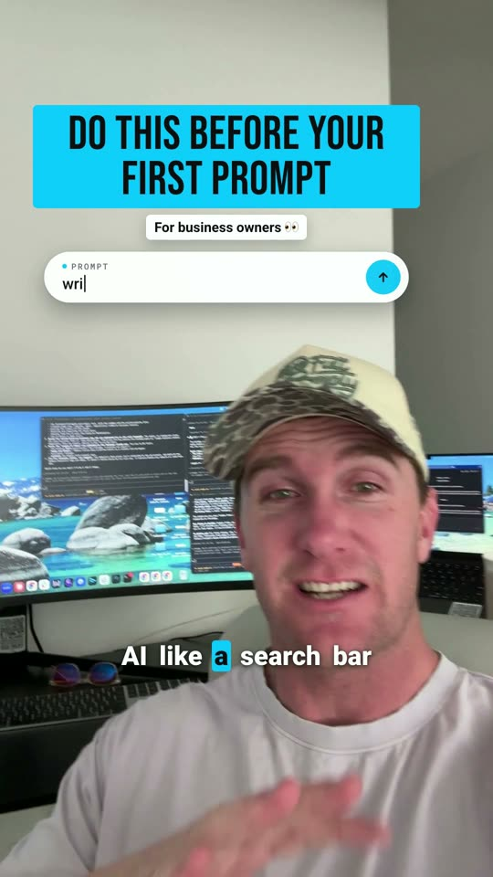
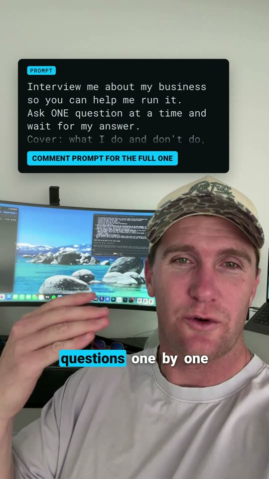
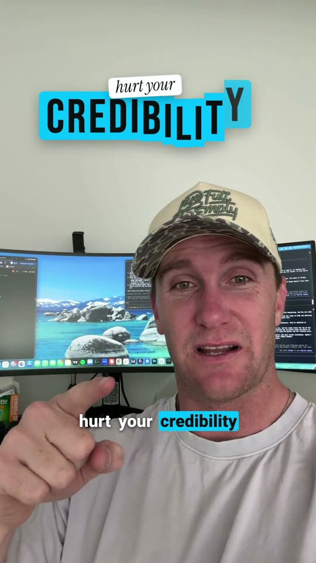

# Reel Kit

**Claude edits your reels. You film one take, and Claude does the cuts, the captions, the cards and the effects.**

This is the kit I use to edit my own reels with no editing app. You install it into Claude Code in two lines. You get the same steps, the same checks and the same 38 effects, re-coloured to your brand.

One owner told me, "I don't want to waste my time doing trial and error." Fair. Most of the trial and error is already done for you, and it's built into this kit.

<p>



</p>

*Real frames from a reel this kit edited. No mockups.*

John Milne · founder, Apex ACQ · [@johnmilne_](https://www.instagram.com/johnmilne_/)

---

## What you get

- **A setup skill.** It checks your computer, installs HyperFrames, makes your Reels folder and builds your look from your colours, fonts and logo.
- **An edit skill.** You say "edit take.mov". It transcribes the take, cuts the pauses and bad takes, and hands you a beat sheet to OK. Then it builds, checks every cut and exports.
- **38 effects, in your colours.** Title cards, numbered steps, a prompt on screen, stat cards with a source tag, before-and-after wipes, a word behind your head, and more. Each one took a full session to build the first time. You get them done.
- **The checks.** Six checks that each caught a real mistake on a real edit, so your reel doesn't go out with it.
- **A practice take.** My raw 3.5-minute take, with every pause, repeated line and false start still in. Edit it before you film your own.

## What you need

- **Claude Code on a paid Claude plan** (Pro, Max, Team or Enterprise). The free plan doesn't include it. Mac, Windows or Linux.
- **Node.js 22 or newer and FFmpeg.** Setup checks for both and installs anything missing, and asks you first.
- **HyperFrames**, the free, open-source engine from HeyGen that turns the edit into an MP4. Setup installs it too.

## Got an editor you love? Keep them.

This isn't for everyone. If someone already edits your videos and you're happy, don't change a thing. You'd be swapping something that works for a learning curve. This is for you if you film stuff that never gets posted because the editing is the bottleneck.

## Install

Open your terminal and paste these two lines:

```
claude plugin marketplace add johnACQ/reel-kit
claude plugin install reel-kit@johnmilne
```

Inside Claude Code, use these instead:

```
/plugin marketplace add johnACQ/reel-kit
/plugin install reel-kit@johnmilne
```

Getting set up is one more line. Make an empty folder called **Reels**, open Claude Code in it, and type:

```
/reel-kit:setup
```

## Edit a reel

1. **Film it.** Read `FILMING-CARD.md` first. Waist up, room above your head, and say the effects out loud ("zoom in on my hand").
2. **Make a folder for the reel** inside Reels and drop the take in.
3. **Say "edit take.mov".**
4. **OK the beat sheet.** You get every moment on paper first: the time, your words, what's on screen and why. Changing a row takes ten seconds. Changing a finished video means a rebuild.
5. **Watch it and give notes** with a time: "0:12, hold that shot longer."
6. **Make the good notes stick.** Say "make that the default" and the next reel starts with it.

## Straight talk

- **It's not one click.** Expect your first full run to take a while: mine took about half an hour from raw clip to finished file, and a fresh install cutting my 3.5-minute practice take took about 50 minutes. A rebuild after notes took about a minute and a half.
- **It's only as good as your footage.** Film tight with your forehead at the top of the frame and there's nowhere for the effects to go.
- **Claude can't hear.** It checks the words at every cut, but it can't hear your video. Watch it once with the sound on before you post.
- **Your first few reels will be simpler than mine.** Start with cuts and captions. Add one effect next time. Every note you save makes the next edit start closer to done.

## Where your files go

Your video stays on your computer. Transcription and background removal run locally through HyperFrames. Claude sees the transcripts and still frames it reads while it works, like any Claude Code session. HyperFrames sends anonymous usage data unless you turn it off: `npx hyperframes telemetry disable` (setup offers to do it for you).

## Credits and licences

- This kit: MIT, see `LICENSE`.
- HyperFrames by HeyGen: Apache 2.0, installed separately from [github.com/heygen-com/hyperframes](https://github.com/heygen-com/hyperframes).
- Fonts bundled with the effects: see `plugin/effects/fonts/LICENSES.md`.
- The practice take is my own footage, yours to practise on. Please don't repost it.
